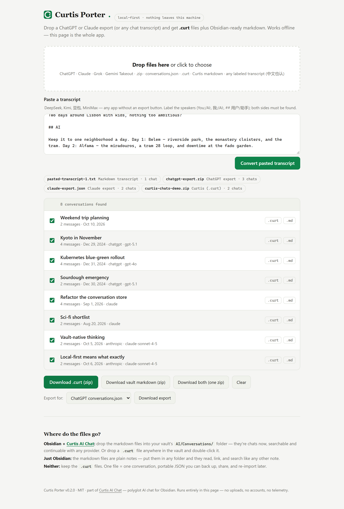

# Curtis AI Porter

<p align="center">
	
</p>

Carry your AI chats anywhere. Port conversations out of ChatGPT, Claude, Grok, Gemini, DeepSeek — any AI tool that can export or copy — into **`.curt` files** (Curtis's portable conversation format) and **Obsidian-ready markdown**. Curtis chats export back out, too: continuation packs, ChatGPT-shape JSON, or API JSONL.

Local-first, like Curtis itself: no accounts, no uploads, no telemetry. The conversion happens on your machine, period.

## Why

Your chat history shouldn't live hostage inside someone else's app. AI exports are hostile JSON dumps (ChatGPT nests messages in a branch tree; Claude mixes text and content blocks; DeepSeek has no bulk export at all). Curtis AI Porter reads all of them and hands you back files you own:

- **`.curt`** — one file, one conversation. Portable JSON: back it up, share it, move it between vaults and machines, re-import it into Curtis anytime. Full fidelity: ids, timestamps, token stats, images, tool calls survive verbatim.
- **Curtis markdown** — drop-in transcript files for your vault's `AI/Conversations/` folder. Searchable in Obsidian, continuable in Curtis with any provider, readable forever as plain notes.

## Use it

### Web UI (for everyone)

Open [the hosted web app](https://curtisai.tech/porter/) and start dropping files. Or run it yourself:

```
npm run build
npm start                 # → http://localhost:7777
```

Or double-click `dist/porter.html` — it's a single self-contained file that runs from disk with no server at all.

<p align="center">
	
</p>

Drag your export zip in, tick the conversations you want, download `.curt` and/or vault markdown. There's also a paste box for tools without an export button: copy a DeepSeek or Gemini chat out of the app, paste it with the speaker labels intact (`You:` / `AI:` or `## You` headings), and get files back. Want to see it driven end to end? `node demo/drive-porter.mjs` (uses the plugin repo's playwright-core) runs a paste + three files through the UI and screenshots the result.

### CLI (for scripting)

```
curt-porter convert <file...> [--out <dir>] [--format curt|md|both] [--zip]
curt-porter export <file...> [--to chatgpt-json|api-jsonl|continuation] [--target chatgpt|claude|gemini|generic] [--out <dir>] [--zip] [--budget <tokens>]
curt-porter verify <file...> [--json]
curt-porter stats <file...> [--json]
curt-porter serve [--port 7777]
```

Examples:

```
node dist/cli.mjs convert ~/Downloads/chatgpt-export.zip
node dist/cli.mjs convert conversations.json --out ./curt --format curt --zip
```

### Export (v0.2.0)

Porting runs both ways now: `.curt` files and Curtis markdown go back out.

```
node dist/cli.mjs export ~/vault/AI/Conversations/*.md --to continuation --zip
node dist/cli.mjs export ./curt/*.curt --to chatgpt-json
```

- **continuation** (default) — a markdown "continuation pack" built to be attached to a ChatGPT, Claude or Gemini chat: a preamble tells the model to adopt the transcript's context and continue from the last message. Turns are trimmed to a token budget (default 30000) that always keeps the first user message plus the most recent turns. `--target chatgpt|claude|gemini` tailors the preamble to the destination app; each pack carries a provenance line (turns, date span, model), and the run reports how many turns fit the budget.
- **chatgpt-json** — a ChatGPT-export-shaped `conversations.json`, for tools that read ChatGPT exports (TypingMind and similar).
- **api-jsonl** — one `{"messages": [...]}` per line, the API shape: replay, fine-tune prep, JSON importers.

After a conversion run, the web UI offers the same three targets as downloads.

### Verify and stats

```
node dist/cli.mjs verify ./curt/*.curt
node dist/cli.mjs stats ~/vault/AI/Conversations/*.md --json
```

- **verify** — the round-trip guarantee as a command: every `.curt` or Curtis markdown file must parse and re-serialize byte-for-byte, or the run exits nonzero. Valid-but-non-canonical files are named (re-save to canonicalize); files that aren't native formats fail too.
- **stats** — what a history contains: conversations, messages, words, tokens, cost, providers, models, monthly activity, largest conversations. Works on any supported input — point it at a ChatGPT export zip, not just Curtis files. `--json` for machines.

### Obsidian plugin

The repo also ships as an Obsidian plugin (`curtis-ai-porter`): a ribbon icon, a "Port chats into this vault…" command, and a right-click "Port into vault (Curtis AI Porter)" on `.zip`/`.json`/`.curt`/`.md`/`.txt` files in the explorer. Ported transcripts are written straight into the vault (output folder is a setting, with an optional `.curt` copy alongside), and "Export ported chats as .curt (zip)" bundles them back up. The plugin is standalone — it works without Curtis AI Chat installed; when both are present, the shared format means ported chats appear in Curtis history immediately.

## What it reads

| Source | You give it | Got from |
|---|---|---|
| ChatGPT | the export zip or `conversations.json` | Settings → Data controls → Export |
| Claude | the export zip or `conversations.json` | Settings → Privacy → Export data |
| Grok | the data-export JSON archive | grok.com → Settings → Data export |
| Gemini | Takeout "My Activity" JSON | takeout.google.com → My Activity |
| Curtis bulk export | the `curtis-chats-*.zip` | Curtis: "Export all chats as .curt (zip)" |
| Curtis (.curt / markdown) | a Curtis portable file or transcript | Curtis: chat header → Save as .curt |
| DeepSeek, Kimi, 豆包, MiniMax, Z.ai, anything | a pasted or saved transcript | select, copy, paste into the web UI (中文标签 我/AI/助手 也认) |

Detection is automatic — you never pick a format. Re-running an import is idempotent: conversations already seen are skipped, so you can't double-port an export.

Details and edge cases: [docs/PORTING.md](docs/PORTING.md).

## Where the files go

- **Obsidian + Curtis AI Chat** — drop the markdown files into your vault's `AI/Conversations/` folder; they appear in Curtis chat history. Or drop a `.curt` file anywhere in the vault and double-click it.
- **Just Obsidian** — the markdown files are plain notes. Put them in any folder.
- **Neither** — keep the `.curt` files. They're the shipping container; re-import into Curtis later or hand them to another tool.

## The `.curt` format

```json
{
	"curt": "curtis-conversation",
	"version": 1,
	"conversation": {
		"id": "conv_1791000000000_abc123def",
		"title": "Weekly review",
		"createdAt": 1791000000000,
		"updatedAt": 1791000600000,
		"provider": "anthropic",
		"model": "claude-sonnet-4-5",
		"messages": [ { "id": "msg_…", "role": "user", "content": "…", "timestamp": 1791000000000 } ]
	}
}
```

One conversation per file, JSON with a magic field and a version. Chosen over markdown for portability: no escaping edge cases, and base64 images or tool-call metadata survive byte-perfect. Both formats are owned by [docs/curt-format.md](docs/curt-format.md) — the normative spec for `.curt` and Curtis markdown (validation, escaping, ids, canonical form).

### What survives the port

`.curt` is the full-fidelity envelope; every foreign source is lossy by nature — the gaps are what those exports actually contain, not what Porter drops.

| Path in | You get | You don't |
|---|---|---|
| `.curt` / Curtis markdown | everything — lossless round-trip | — |
| ChatGPT export | title, timestamps (sec precision), model per assistant turn | system/tool turns, images (CDN pointers, not data), regenerations collapse to one chain |
| Claude export | title, timestamps, message text | attachments, tool-use blocks, model (export has none) |
| Grok archive | title, timestamps, roles | system messages, attachments |
| Gemini Takeout | prompts + answers (both required), timestamps, chats split at 3 h gaps | anything Takeout leaves out |
| paste / generic JSON | roles + content | timestamps, model |

Curtis-native data — token counts, cost, images, tool calls, agent/skill/swarm linkage, memory references — exists in **no** competitor's export. Only `.curt` carries it out. Full matrix: [docs/curt-format.md → Fidelity](docs/curt-format.md).

## Development

```
npm install
npm run build    # type-check + bundle CLI and web page
npm test         # the contract suite (incl. a live-repo run when the plugin repo sits next door)
```

`src/core/` mirrors the plugin's `src/import/` module file-for-file — see [AGENTS.md](AGENTS.md) before touching either side.

The contract tests are the load-bearing guarantee: they feed the porter's output through the plugin's **actual parsers** and require round-trip equality. The parsers are vendored verbatim under `test/curtis-reference/` (pinned to a plugin version), so the suite is self-contained; when the real `curtis-ai-chat` repo sits next door, the same suite additionally runs against its live code. If those tests pass, "drop it in the vault and it works" is true, not aspirational.

## Status

v1.0.0 — first release under the Curtis AI Porter name. Source-available under BUSL-1.1 (converts to MIT on 2030-10-12). Predecessor releases (Curtis AI Chat Porter v0.2.x) were MIT and are discontinued.

v0.2.6 — relicensed from MIT to BUSL-1.1 (source-available; converts to MIT on 2030-10-12). All releases prior to v0.2.6 remain MIT.

v0.2.2 — contract synced to Curtis.ai v2.0.1: agent/skill provenance (`agentId` on conversations and messages, `skillIds` on conversations) now round-trips through `.curt` and the markdown projection; Curtis.ai full-backup zips are covered by tests. TypeScript compiles under full `strict`.

v0.2.1 — plugin review fixes: requires Obsidian 1.7.2+; settings appear in Obsidian's settings search (declarative settings API); the web UI builds its chat list without HTML strings; GitHub releases carry build-provenance attestations (`gh attestation verify`).

v0.2.0 — working imports: ChatGPT, Claude, Grok, Gemini Takeout, `.curt`, Curtis markdown, Curtis bulk-export zip, generic JSON, generic markdown/paste — via CLI, web UI, or the Obsidian plugin. New: the export direction — continuation packs (attach a transcript to a live ChatGPT/Claude/Gemini chat and continue), ChatGPT-shape `conversations.json`, and API JSONL. New in the CLI: `verify` (prove files round-trip) and `stats` (aggregate a history), and `--target` continuation packs. Not yet: image export from foreign formats; bulk import into ChatGPT/Claude/Gemini — no platform offers a write API, which is exactly what the continuation pack works around. DeepSeek still has no bulk export; the paste path covers it.

Part of the [Curtis](https://github.com/JordanNewell/curtis-ai-chat) family.

## License

Source-available under [BUSL-1.1](LICENSE) — Copyright (c) 2026 Jordan Newell (Curtis AI). Converts to MIT on 2030-10-12 (the Change Date); releases prior to v0.2.6 remain MIT.
